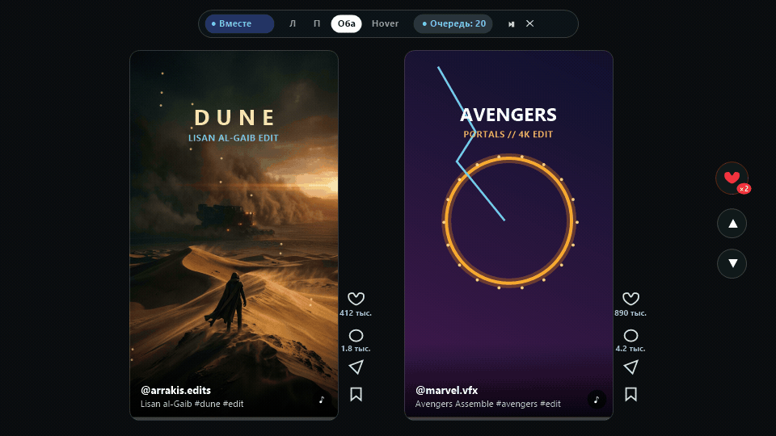

<div align="center">

# Dual Reels for Instagram

**Смотри 2 уникальных Instagram Reels одновременно — прямо в одной вкладке браузера**

Величайший рофл проект по мнению Hacker4876

Синхронная или раздельная прокрутка, буфер на 20+ роликов или живая лента, тихие лайки и сохранения в избранное без всплывающих окон, отправка друзьям в Direct и отдельный регулятор громкости для каждого видео.

[](https://github.com/apexFrog/insta-dual-reels)
[](#установка-и-запуск)
[](#установка-и-запуск)
[](https://www.instagram.com/reels/)

<br>



</div>

---

## Возможности

- **Два Reels в одной вкладке** — никаких вторых окон и заблокированных фреймов: расширение открывает чистый двухэкранный плеер прямо внутри вкладки `instagram.com/reels/`.
- **Ноль повторов** — единая очередь с дедупликацией по ID и URL гарантирует, что левая и правая колонки всегда показывают разные ролики.
- **Прокрутка «Вместе» или «Отдельно»** — листайте оба видео синхронно колёсиком мыши / стрелками или переключитесь в раздельный режим, чтобы листать левую и правую ленту независимо.
- **Два режима ленты: «Очередь (20+)» и «Живая ⚡»** — держите запас из 20+ предзагруженных рилсов для мгновенного скролла либо отключите буфер, чтобы рекомендации подстраивались в реальном времени.
- **Тихие лайки, «Лайк ×2» и Избранное (🔖)** — одиночный лайк, двойной клик по видео, кнопка **`❤️×2`** для обоих рилсов сразу и сохранение в избранное работают в фоне через `chrome.webRequest` и родные GraphQL-мутации без всплывающих окон и без риска вылета из аккаунта.
- **Поделиться с другом в Direct (✈️)** — по клику на самолётик сразу открывается родное окно «Поделиться» со списком ваших друзей и чатов.
- **Гибкое управление звуком и громкостью** — 5 режимов звука в верхней панели (**Л**, **П**, **Оба**, **Hover** по наведению мыши, **🔇**) + отдельный вертикальный ползунок громкости (`0–100%`) на каждом видео и полная поддержка раздельных DASH-аудиодорожек Instagram.
- **Работает строго на вкладке Reels** — плагин не вмешивается в главную ленту, профиль и переписки.

---

## Установка и запуск

1. Склонируйте репозиторий или скачайте архив (`Code → Download ZIP`) и распакуйте его в любую папку:
   ```bash
   git clone https://github.com/apexFrog/insta-dual-reels.git
   ```
2. Откройте в Chrome / Edge / Brave страницу расширений: `chrome://extensions/`.
3. Включите **Режим разработчика** (переключатель в правом верхнем углу).
4. Нажмите **Загрузить распакованное расширение** и выберите папку `insta-dual-reels`.
5. Откройте `https://www.instagram.com/reels/` и нажмите кнопку **Dual Reels** в правом верхнем углу (или кликните на иконку расширения).

---

## Горячие клавиши

| Клавиша | Действие |
| :--- | :--- |
| `S` | Переключить прокрутку **Вместе / Отдельно** |
| `Q` | Переключить ленту **Буфер (20+) / Живая ⚡** |
| `L` | **Лайк ×2** (поставить лайк обоим рилсам сразу) |
| `↑` / `↓` | Предыдущие / следующие рилсы |
| `Space` | Пауза / воспроизведение обоих видео |
| `1` / `2` / `3` | Звук: только **Левый** / только **Правый** / **Оба** |
| `4` | Режим **Hover** (звук включается там, где курсор) |
| `M` | Выключить / вернуть звук |
| `Esc` | Выйти из режима Dual Reels |

> **Подсказка:** одиночный клик по видео ставит его на паузу, двойной клик — ставит лайк, а наведение на иконку **🔊** в правом нижнем углу видео открывает ползунок громкости.

---

## Структура проекта

```text
insta-dual-reels/
├── assets/
│   └── demo.gif          # Демонстрация работы двойной ленты
├── icons/
│   ├── icon16.png
│   ├── icon48.png
│   └── icon128.png
├── manifest.json         # Конфигурация Chrome Extension (Manifest V3)
├── background.js         # Service Worker: webRequest-обучение и тихие фоновые действия
├── injected.js           # MAIN-мир: перехват ленты, DASH-аудио и повтор GraphQL-мутаций
├── content.js            # Двухэкранный плеер, очередь, HUD, звук, лайки и Direct
├── styles.css            # Стили плеера, HUD-панели и регуляторов громкости
├── popup.html            # Всплывающее меню расширения
└── popup.js              # Логика popup-меню
```
